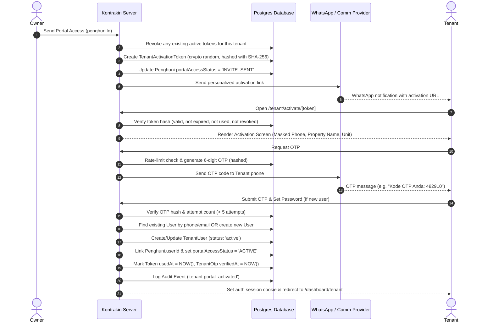

# Tenant Portal Activation — Implementation Plan & Architecture Specification

> **Status:** Implementation Phase  
> **Date:** October 2026  
> **Scope:** Frictionless Tenant Onboarding, Secure Tokenized Links, WhatsApp/Email OTP Verification & Multi-Tenancy Account Linking

---

## 1. Executive Summary & Objective

The primary objective is to replace the manual tenant invitation code system (`kodeUndangan` copy-pasting) with a modern, zero-friction **Tenant Portal Activation** flow.

### Target Workflow:
```text
Owner creates Tenant (Name, WhatsApp Phone, Email)
        ↓
Owner creates / activates Lease
        ↓
System generates secure single-use activation token & sends access via WhatsApp / Email
        ↓
Tenant taps secure activation link: https://app.kontrakin.com/tenant/activate/[token]
        ↓
Tenant verifies OTP sent to their WhatsApp/Email (verifying identity & phone ownership)
        ↓
Existing User account is reused OR new User account is securely provisioned & logged in
        ↓
Tenant enters Tenant Portal (/dashboard/tenant) with unit, lease, bills & maintenance loaded
```

### Core Principles & Invariants:
1. **NO manual invitation codes** to copy, paste, or memorize.
2. **NO prior registration required** before Owner creates the tenant.
3. **Decoupled Architecture:** `Tenant` (`Penghuni`) is a business entity; `User` is an authentication identity.
4. **Multi-Tenancy Isolation:** `organization_id` strictly enforced on token generation, OTP verification, and tenant portal queries.
5. **Security by Design:** Tokens and OTPs stored as cryptographic SHA-256 hashes; single-use, revocable, rate-limited, and expiring (48 hours).
6. **Zero Regression:** Existing active tenant accounts and legacy `kodeUndangan` columns preserved without breaking migrations.

---

## 2. Current State vs Target Architecture

| Aspect | Current Implementation | Target Implementation |
| :--- | :--- | :--- |
| **Tenant Creation** | Owner inputs Name & Phone in `Penghuni`. | Owner inputs Name & Phone in `Penghuni`. Tenant can be created immediately without user account. |
| **Onboarding Method** | Owner copies 8-character `kodeUndangan` from Settings. Tenant registers manually, navigates to `/dashboard/tenant/kontrak`, and submits code. | Owner clicks **"Kirim Akses Portal"** (or auto-sent on lease activation). System sends direct activation link via WhatsApp/Email. |
| **Identity Verification** | Manual form entry matching owner's code. | Cryptographic activation link + WhatsApp/Email 6-digit OTP verification. |
| **Account Linking** | 1:1 `Penghuni.userId` unique constraint. | `TenantUser` (`tenant_user`) relationship supporting multiple tenancies per user, with `Penghuni.userId` retained for backward compatibility. |
| **Portal Access State** | Binary (`userId != null` or `null`). | Stored status: `NOT_SENT`, `INVITE_SENT`, `ACTIVATION_PENDING`, `ACTIVE`, `DISABLED`. |
| **Resend & Revoke** | Not possible without manual coordination. | 1-click **"Kirim Ulang Akses"** (revokes previous token) or **"Nonaktifkan Akses"**. |

---

## 3. Database Schema Extensions

### 3.1 `Penghuni` (`penghuni`) Updates
- `portalAccessStatus`: String (`NOT_SENT` | `INVITE_SENT` | `ACTIVATION_PENDING` | `ACTIVE` | `DISABLED`), default `"NOT_SENT"`.
- `portalActivatedAt`: DateTime nullable.
- `lastPortalAccessAt`: DateTime nullable.

### 3.2 `TenantUser` (`tenant_user`)
Links authentication identities (`User`) with property rental entities (`Penghuni`).
```prisma
model TenantUser {
  id             String       @id @default(cuid())
  tenantId       String       @map("tenant_id")
  userId         String       @map("user_id")
  status         String       @default("active") // active, disabled
  linkedAt       DateTime     @default(now()) @map("linked_at")
  createdAt      DateTime     @default(now())
  updatedAt      DateTime     @updatedAt
  penghuni       Penghuni     @relation(fields: [tenantId], references: [id], onDelete: Cascade)
  user           User         @relation(fields: [userId], references: [id], onDelete: Cascade)

  @@unique([tenantId, userId])
  @@index([userId])
  @@index([tenantId])
  @@map("tenant_user")
}
```

### 3.3 `TenantActivationToken` (`tenant_activation_token`)
Stores hashed activation tokens with expiration and single-use enforcement.
```prisma
model TenantActivationToken {
  id             String       @id @default(cuid())
  tenantId       String       @map("tenant_id")
  organizationId String       @map("organization_id")
  tokenHash      String       @unique @map("token_hash")
  phone          String?
  email          String?
  channel        String       @default("whatsapp") // whatsapp, email
  expiresAt      DateTime     @map("expires_at")
  usedAt         DateTime?    @map("used_at")
  revokedAt      DateTime?    @map("revoked_at")
  createdAt      DateTime     @default(now())
  updatedAt      DateTime     @updatedAt
  penghuni       Penghuni     @relation(fields: [tenantId], references: [id], onDelete: Cascade)
  organization   Organization @relation(fields: [organizationId], references: [id], onDelete: Cascade)
  otps           TenantOtp[]

  @@index([tenantId])
  @@index([organizationId])
  @@index([tokenHash])
  @@map("tenant_activation_token")
}
```

### 3.4 `TenantOtp` (`tenant_otp`)
Stores secure hashed OTPs with attempt limiting and TTL.
```prisma
model TenantOtp {
  id             String                @id @default(cuid())
  tokenId        String                @map("token_id")
  identifier     String                // phone or email
  otpHash        String                @map("otp_hash")
  attempts       Int                   @default(0)
  expiresAt      DateTime              @map("expires_at")
  verifiedAt     DateTime?             @map("verified_at")
  createdAt      DateTime              @default(now())
  token          TenantActivationToken @relation(fields: [tokenId], references: [id], onDelete: Cascade)

  @@index([tokenId])
  @@index([identifier])
  @@map("tenant_otp")
}
```

---

## 4. Activation & Verification Workflow



---

## 5. Security & Isolation Matrix

1. **Token Secrecy:** Only `SHA-256(rawToken)` is stored in the database. Raw token is only visible in the activation URL dispatched to the tenant.
2. **OTP Secrecy:** Only `SHA-256(otpCode)` is stored. Never logged in audit logs, system console, or API responses.
3. **Information Disclosure Prevention:** An invalid or expired token returns a generic *"Link aktivasi tidak valid atau telah kedaluwarsa"* without leaking property names, tenant names, or phone numbers.
4. **Rate Limiting & Anti-Bruteforce:**
   - OTP resend cooldown: 60 seconds minimum.
   - OTP maximum attempts: 5 attempts before invalidating the OTP.
   - Token validity window: 48 hours (configurable).
5. **Multi-Tenant Protection:**
   - Token creation requires `organizationId` matching caller's active organization.
   - Activation links are bound to the specific `tenantId` and `organizationId`.

---

## 6. Implementation Phases & Milestones

- [x] **Phase 1: Architecture & Current System Audit**
- [x] **Phase 2: Database Schema & Migration** (`tenant_user`, `tenant_activation_token`, `tenant_otp`, `Penghuni.portalAccessStatus`, Prisma client generated, schema synced)
- [x] **Phase 3: Core Domain Services**
  - `lib/services/tenant-activation-service.ts` (token generation, SHA-256 hashing, OTP dispatch, account linking, idempotency, rate limiting)
  - Messaging templates: `tenant_portal_activation` & `tenant_activation_otp` in `lib/communication/templates.ts`
- [x] **Phase 4: Owner Portal Management UX**
  - Tenant 360 Drawer: Portal Access Card (`Status`, `Kirim Akses`, `Kirim Ulang`, `Nonaktifkan`, `Aktifkan Kembali`)
  - Server actions: `sendTenantPortalAccessAction`, `resendTenantPortalAccessAction`, `disableTenantPortalAccessAction`
  - Lease Creation dialog: "Kirim Akses Tenant Portal via WhatsApp" checkbox option & auto-send
- [x] **Phase 5: Tenant Activation Public Route & Flow**
  - Public route: `/tenant/activate/[token]` with mobile-first layout (min 44px touch targets)
  - Masked contact display (`0812••••••90`)
  - OTP request & verification state machine with 60s cooldown timer
  - Account creation / session cookie establishment with seamless transition to `/dashboard/tenant`
  - Safe error screens for `EXPIRED`, `USED`, `REVOKED`, and `INVALID` tokens
- [x] **Phase 6: Backward Compatibility & Clean-up**
  - Modernized `/dashboard/tenant/kontrak` (clear guidance without mandatory manual code entry; legacy code entry retained as optional accordion)
  - Modernized `/dashboard/owner/pengaturan` (updated tab title to "Akses Portal Tenant" with explanation of automated onboarding)
- [x] **Phase 7: Test Coverage & Verification**
  - Unit & Integration tests in `tests/tenant-portal-activation.test.mjs` verifying cryptography, hashing, masking, templates, state machines, OTP brute-force limits, and cross-organization isolation
  - 57 tests passing across the test suite (`npm test`)
  - `npm run typecheck` (`tsc --noEmit`) passes cleanly with zero errors
- [x] **Phase 8: Public Tenant Registration Removal & Route Deprecation**
  - Removed public "Register as Tenant" and role selector from `/register` page; public registration is strictly for Owner accounts
  - Backend database hook enforces `role: "owner"` on all public registrations, neutralizing client-side role injection attempts
  - Created `/register/tenant` deprecated route providing an informational migration notice directing users to login or request activation from their property owner
  - Added dedicated test suite `tests/public-registration-policy.test.mjs` (62 total tests passing)

